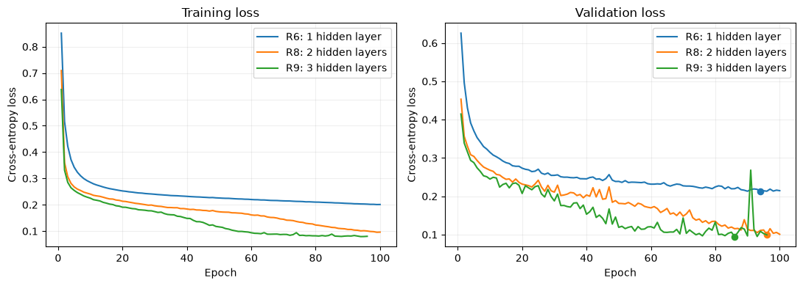
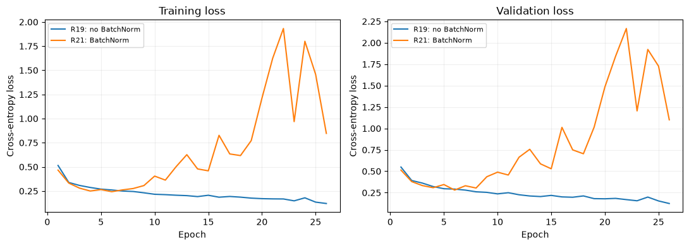

# AI × Cybersecurity — Feed-forward Network Experiments

**Zehua Wang · MSc Cybersecurity, Politecnico di Torino**

[中文说明](README.zh-CN.md)

A personal Lab 1 experiment portfolio on four-class network-traffic classification: **Benign, Brute Force, DoS Hulk and PortScan**. It documents preprocessing, destination-port sensitivity, class weighting, network depth, batch size, optimizer choice, learning rate and regularization.

The main aim is to explain **what changed, what was expected and what the evidence showed**, including failed hypotheses. The repository contains **21 numbered configurations, R1–R21**; repeated executions of the same configuration were not exhaustively counted.

This is a course-based learning project, not a production intrusion-detection system. Notebook explanations and the detailed logbook are mainly in Chinese.

## Main findings

- **Destination-port sensitivity:** with R1 fixed, changing the destination port of 286 Brute Force test records from 80 to 8080 reduced BF recall from **0.9371 to 0.0594**. Predictions of Benign among these records rose from 3 to 254. This is evidence of sensitivity to that intervention, not proof that the network uses only the port.
- **Depth helped more than the larger regularized network:** R9, with three hidden layers of width 64, achieved validation Macro-F1 **0.9609**. The Task6 selection R19 used about five times as many parameters without a higher validation or test Macro-F1.
- **Changes were not uniformly beneficial:** class weighting did not improve BF recall; the tested Dropout configuration did not clearly improve stability; the tested BatchNorm configuration worsened both training and validation evaluation losses.

## Final comparison

Task5 and Task6 candidates were selected by **validation Macro-F1** before their fixed test evaluation. Within each configuration, checkpoint selection used validation loss; R17 explicitly evaluated its final epoch instead. The following three models share the same **port-free test partition of 6,296 records**.

| Model | Hidden layers | Parameters | Validation Macro-F1 | Test Accuracy | Test Macro-F1 | Test BF recall |
|---|---|---:|---:|---:|---:|---:|
| R6: simple baseline | 64 | 1,284 | 0.8986 | 0.9176 | 0.8903 | 0.9007 |
| **R9: selected model** | **64, 64, 64** | **9,604** | **0.9609** | **0.9636** | **0.9478** | **0.9040** |
| R19: Task6 selection | 256, 128, 64, 32, 16 | 47,924 | 0.9599 | 0.9616 | 0.9453 | 0.9007 |

R9 improved test Accuracy and Macro-F1 over R6 by **4.60 and 5.75 percentage points**, respectively. Its test DoS Hulk recall remained **0.8373**, a limitation. Misclassifying one attack subtype as another is distinct from classifying an attack as Benign.

**R9 configuration:** 15 input features → 64 → 64 → 64 → 4 logits; ReLU; unweighted cross-entropy; AdamW with learning rate 0.0005 and weight decay 0; batch size 64; maximum 100 epochs; patience 10; seed 42. It stopped after 96 epochs and restored epoch 86.

## Experimental coverage

| Stage | Question | Numbered configurations |
|---|---|---|
| Preprocessing | Invalid numbers, duplicate handling, splitting, scaling | No training |
| Task2 | Baseline; no scaling; extreme learning rates; Identity activation | R1–R5 |
| Task3 | Fixed-model port counterfactual; duplicate impact after removing port | No additional training |
| Task4 | Port-free baseline; train-only class weights | R6–R7 |
| Task5 | Depth; batches 8/64/1024; SGD, momentum and AdamW at two rates | R8–R16, reusing R6 |
| Task6 | Large network; early stopping; weight decay; Dropout; BatchNorm | R17–R21 |



The tested BatchNorm variant is retained as a negative result. These curves do not establish the underlying failure mechanism.



## Data and split design

The original course CSV has **31,507 rows, 16 input features and one label column**. The union of rows containing missing values, infinities or negative input values contains 29 rows, leaving **31,478 valid records**.

Two deliberately distinct pipelines are documented:

1. **With destination port:** remove 2,094 additional exact duplicates, leaving 29,384 records; stratify into 17,630 / 5,877 / 5,877 train/validation/test records using seed 42.
2. **Without destination port:** reload the original CSV, drop the port and remove invalid rows. Keep valid repeated records because direct deduplication would reduce PortScan from 4,849 records in the with-port cleaned data to 285. Group by all 15 input features, without the label. Use five-fold `StratifiedGroupKFold`, with fold 0 for test, fold 1 for validation and folds 2–4 for training: **18,886 / 6,296 / 6,296** records. Assertions check that identical input groups do not cross partitions.

Scalers and label encoders are fit only on training data. Class weights are computed only from training labels. Group separation here addresses identical feature vectors; it does not establish independence by host, session or capture time. Since deduplication and partitions also change, R1 versus R6 is **not** a pure single-feature ablation.

## Repository contents

| Path | Content |
|---|---|
| [lab1/lab1_zehua.ipynb](lab1/lab1_zehua.ipynb) | Executed experiment notebook with preserved numerical results and plots |
| [lab1/lab1_zehua.html](lab1/lab1_zehua.html) | Offline HTML export; download and open locally to view it |
| [lab1/logbook_zehua.md](lab1/logbook_zehua.md) | Original hypotheses, results, failures, selection decisions and timing provenance |
| [figures/](figures/) | Four plots extracted directly from saved notebook outputs |
| [requirements.txt](requirements.txt) | Recorded top-level dependency versions |
| [environment/](environment/) | Original dependency snapshot and environment notes |
| [docs/PUBLICATION_NOTES.md](docs/PUBLICATION_NOTES.md) | Snapshot changes, validation scope and provenance |
| [docs/UPLOAD_GUIDE.zh-CN.md](docs/UPLOAD_GUIDE.zh-CN.md) | Chinese instructions for the first GitHub upload |

## Reproduce

### Obtain the data

Use `dataset_lab_1.csv` from the course materials and copy it to **`lab1/dataset_lab_1.csv`**. The raw CSV is not bundled in this repository. Its expected SHA-256 is:

```text
16342d53b3a502ea7727d07bdf22d0f38e1abc5a23d01c42b0dd5770d6e5e125
```

The repository excludes generated weights and per-epoch CSV files. A full top-to-bottom run generates them; the recovery section then reads the files created earlier in that run. To resume after a kernel restart, retain the locally generated checkpoints and histories and perform the necessary imports first.

### Environment and execution

Recorded environment: **Windows, Conda, Python 3.12.16, PyTorch 2.14.1+cpu**. Reuse the original `ai-labs` environment if available. Otherwise, an example setup from the repository root is:

```powershell
conda create -n ai-cyber-lab1 python=3.12
conda activate ai-cyber-lab1
python -m pip install -r requirements.txt
python -m ipykernel install --user --name ai-cyber-lab1 --display-name "Python (ai-cyber-lab1)"
cd lab1
jupyter lab lab1_zehua.ipynb
```

Select the intended kernel and run cells in order with `lab1/` as the working directory. The original `%pip install torch==2.14.1` cell is retained; skip it when the recorded dependencies are already installed. Executing all cells retrains all numbered configurations and writes run artifacts into `lab1/`. Use a separate working copy to preserve earlier local runs.

**For viewing only:** open the saved notebook, or download `lab1_zehua.html` and open it in a browser. Re-training is unnecessary for reading the results.

The recorded dependency stack was not installed or end-to-end re-tested while packaging this snapshot. The top-level pins and original snapshot describe provenance, rather than a verified installation guarantee on every platform.

## Limits and reproducibility notes

- Conclusions use one recorded split and seed, without multi-seed confidence intervals.
- Batch-size comparisons use an epoch cap, so smaller batches perform more updates; they are not equal-update or equal-time comparisons.
- Task6 logs training loss in evaluation mode at the end of each epoch. Earlier experiments average training-batch losses during optimization, so those training-loss definitions differ.
- Some configurations were rerun. Initial logbook timings differ from current saved notebook timings; the logbook lists both. They must not be mixed into a single speed benchmark.
- Packaging preserves all **82 non-empty experiment code cells**, their execution counts, numerical results and **14 embedded plots**. It changes explanatory text and hides local machine paths. It does not rerun training.

## Attribution

Personal experimental work prepared by **Zehua Wang / 王泽华** for the *AI and Cybersecurity* course at **Politecnico di Torino**, developed in the context of Group 22. The experiment code and explanations were developed with ChatGPT-assisted coding and tutoring. Original course handouts, the dataset and other group members' report files are not redistributed in this snapshot.
