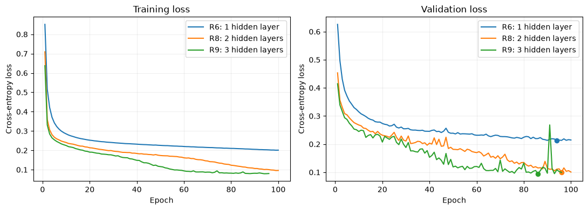

# AI × Cybersecurity — 前馈神经网络实验

**王泽华 / Zehua Wang · 都灵理工大学网络安全硕士**

[English](README.md)

这是我的 Lab1 个人实验版本，研究前馈神经网络如何区分四类网络流量：Benign、Brute Force、DoS Hulk、PortScan。实验在 Group 22 课程项目背景下完成，记录 **R1–R21 共 21 个编号配置**，包含训练前假设、对照、失败结果和模型选择依据；同一配置的重复执行没有另行穷举计数。

## 主要结果

- **目的端口敏感性**：固定 R1，只把测试集中 286 条 BF 样本的目的端口从 80 改为 8080，BF Recall 从 **0.9371 降至 0.0594**；预测为 Benign 的数量从 3 增至 254。这说明模型对该干预敏感，不能据此断言只使用端口。
- **增加深度有效**：三隐藏层 R9 的验证 Macro-F1 为 **0.9609**。最终保留依据验证集选出的 R9，测试 Accuracy 为 **0.9636**，Macro-F1 为 **0.9478**。
- **大网络没有进一步胜出**：Task6 选择的 R19 参数约为 R9 的 5 倍，但验证和测试 Macro-F1 均未超过 R9。类别加权、Dropout、BatchNorm 在测试的设置下也没有一致改善结果。

三个模型使用同一去端口测试集（6,296 条记录）。每个配置内部以验证损失选择检查点；Task5/Task6 以验证 Macro-F1 选择候选，再固定进行测试。R17 单独使用第 200 轮末模型。

| 模型 | 隐藏层 | 参数量 | 验证 Macro-F1 | 测试 Accuracy | 测试 Macro-F1 |
|---|---|---:|---:|---:|---:|
| R6：简单基线 | 64 | 1,284 | 0.8986 | 0.9176 | 0.8903 |
| **R9：最终选择** | **64,64,64** | **9,604** | **0.9609** | **0.9636** | **0.9478** |
| R19：Task6 选择 | 256,128,64,32,16 | 47,924 | 0.9599 | 0.9616 | 0.9453 |

R9 相对 R6 的测试 Accuracy、Macro-F1 分别提高 4.60、5.75 个百分点。DoS Hulk Recall 仍为 0.8373，是现有结果的局限。



R9 配置为 15→64→64→64→4、ReLU、普通交叉熵、AdamW（lr=0.0005，weight_decay=0）、batch=64、最多 100 轮、patience=10、seed=42。实际训练 96 轮，恢复第 86 轮检查点。

## 实验范围与划分

| 阶段 | 内容 | 配置 |
|---|---|---|
| Task1 | 异常行、重复、分区与标准化 | 无训练 |
| Task2 | 基线、取消标准化、极端学习率、Identity | R1–R5 |
| Task3 | 固定模型的端口干预、去端口后的重复问题 | 无新增训练 |
| Task4 | 去端口新基线与类别加权 | R6–R7 |
| Task5 | 深度、batch size、优化器和学习率 | R8–R16，复用 R6 |
| Task6 | 大网络、早停、weight decay、Dropout、BatchNorm | R17–R21 |

原始数据为 31,507 行、16 个输入特征和标签。去除包含缺失、无穷或负特征值的 29 行后，剩余 31,478 行。

1. **带端口流程**：再去除 2,094 条完全重复记录，剩余 29,384 行；以 seed=42 分层划分为 17,630 / 5,877 / 5,877。
2. **去端口流程**：重新读取原始数据、移除端口并清除无效行，保留重复记录。按全部 15 个输入特征分组，标签不参与分组，用五折 StratifiedGroupKFold 划分为 18,886 / 6,296 / 6,296。断言检查相同输入组不跨分区。

标准化器、标签编码器和类别权重只使用训练集拟合或计算。分组不代表主机、会话或时间上的独立。R1 与 R6 的去重和分区也不同，不能作为纯粹的端口消融对照。

## 查看与复现

- [带完整输出的 notebook](lab1/lab1_zehua.ipynb)
- [离线 HTML](lab1/lab1_zehua.html)：下载后在浏览器中打开
- [实验 logbook](lab1/logbook_zehua.md)：假设、结果、结论与运行时间来源
- [环境说明](environment/README.md)与[顶层依赖](requirements.txt)
- [发布说明](docs/PUBLICATION_NOTES.md)

仅查看结果无需重新训练。复现时从课程材料获取 `dataset_lab_1.csv`，放在 `lab1/` 目录；原始数据和训练权重不随仓库发布。

数据的 LF 换行版本 SHA-256 为：

```text
16342d53b3a502ea7727d07bdf22d0f38e1abc5a23d01c42b0dd5770d6e5e125
```

原 Windows CRLF 换行版本 SHA-256 为 `d71ac2a6ddb4f8f0f5f0ad3cd67787b9dc8304d3d5a4c9143259ce6d45601fc9`，CSV 内容一致。

原环境为 Windows、Conda、Python 3.12.16、PyTorch 2.14.1+cpu。可复用 `ai-labs` 环境；从仓库根目录新建环境的示例：

```powershell
conda create -n ai-cyber-lab1 python=3.12
conda activate ai-cyber-lab1
python -m pip install -r requirements.txt
python -m ipykernel install --user --name ai-cyber-lab1 --display-name "Python (ai-cyber-lab1)"
cd lab1
jupyter lab lab1_zehua.ipynb
```

选择对应 kernel，以 `lab1/` 为工作目录按顺序运行。原 `%pip install torch==2.14.1` 单元格保留，已有依赖时可跳过。完整运行会重新训练并生成权重与历史，建议使用单独副本。中间的恢复区读取本次前面生成的 R1–R7 文件；重启 kernel 后单独恢复需先导入依赖并保留这些本地文件。

打包时未重新安装依赖或完整运行训练；版本信息用于记录来源，不能保证所有平台都可直接安装。

## 结果边界与来源

本次保留 **82 个非空实验代码单元格、原执行计数、数值输出和 14 张嵌入图**。整理添加说明并隐藏输出中的本机绝对路径，未重新训练。

结论来自单次划分与一个随机种子，没有多种子的置信区间。batch 对照采用相同轮数上限，更新次数并不相同。Task6 的训练损失是在每轮末的 eval 模式计算，此前实验使用训练过程中的 batch 平均损失。部分配置曾重跑，logbook 列出初始记录和当前 notebook 输出的用时，两者不能混成一个速度基准。

本项目为 **Zehua Wang / 王泽华** 在都灵理工大学 *AI and Cybersecurity* 课程中的个人学习实验，开发过程中使用了 ChatGPT 辅助编程与学习。公开版本不包含原始课程讲义、数据或其他组员的报告文件，不作为生产环境入侵检测系统。
